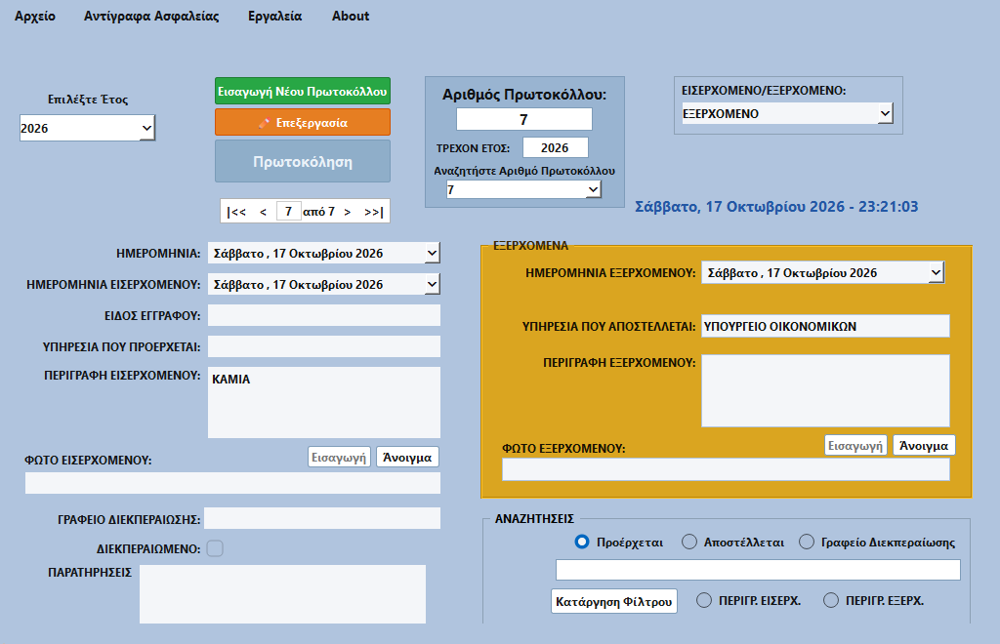

# 🏛️ Ηλεκτρονικό Πρωτόκολλο Εγγράφων

> **Σύγχρονη, αξιόπιστη και εύχρηστη εφαρμογή διαχείρισης πρωτοκόλλου εγγράφων (Εισερχομένων & Εξερχομένων) για τα Windows.**  
> Ιδανική για δημόσιες υπηρεσίες, γραφεία, επιχειρήσεις και οργανισμούς.

---

## 📥 Λήψη Εφαρμογής για Windows

Μπορείτε να κατεβάσετε άμεσα την εφαρμογή χωρίς καμία ανάγκη εγκατάστασης Python ή εξωτερικών προαπαιτούμενων:

| Τύπος Πακέτου | Περιγραφή | Σύνδεσμος Λήψης |
| :--- | :--- | :--- |
| **🚀 Πρόγραμμα Εγκατάστασης (Installer)** | *Συνιστάται.* Αυτόματη εγκατάσταση, συντομεύσεις στην Επιφάνεια Εργασίας & Μενού Έναρξης, σύστημα αυτόματων ενημερώσεων. | [**⬇️ Λήψη Installer (.exe)**](https://github.com/grcomandos83-cyber/ELECTRONIC-DOCUMENT-PROTOCOL/releases/latest/download/Protocol_Setup_Latest.exe) |
| **🗜️ Φορητή Έκδοση (Portable ZIP)** | Εκτελείται άμεσα χωρίς εγκατάσταση (π.χ. από USB flash drive). Αποσυμπιέστε και εκτελέστε το `Protokollo.exe`. | [**⬇️ Λήψη Portable (.zip)**](https://github.com/grcomandos83-cyber/ELECTRONIC-DOCUMENT-PROTOCOL/releases/latest/download/Protocol_Portable_Latest.zip) |

👉 **[Δείτε όλες τις διαθέσιμες εκδόσεις & σημειώσεις έκδοσης (GitHub Releases)](https://github.com/grcomandos83-cyber/ELECTRONIC-DOCUMENT-PROTOCOL/releases/latest)**

---

## 📸 Προεπισκόπηση Εφαρμογής

---

## ⚡ Γιατί να την επιλέξετε;

- 🚫 **Χωρίς περίπλοκες ρυθμίσεις:** Δεν απαιτείται Python, βάσεις διακομιστή ή γνώσεις πληροφορικής. Κάνετε διπλό κλικ και λειτουργεί!
- 🔄 **Αυτόματες Ενημερώσεις (Auto-Update):** Κάθε φορά που ανοίγει, η εφαρμογή ελέγχει διακριτικά για νέες εκδόσεις και σας ενημερώνει για άμεση αναβάθμιση με ένα κλικ.
- 🔒 **100% Τοπική & Ασφαλής:** Όλα τα δεδομένα, τα αρχεία και τα πρωτόκολλα παραμένουν αποκλειστικά στον υπολογιστή σας. Καμία πληροφορία δεν διαρρέει στο διαδίκτυο.
- 🛡️ **Αυτόματα Αντίγραφα Ασφαλείας:** Ενσωματωμένο σύστημα ασφαλείας που προστατεύει τις εγγραφές σας από τυχαία απώλεια.

---

## 🚀 Οδηγίες Εγκατάστασης σε 3 Βήματα

1. **Λήψη:** Πατήστε στο κουμπί [**⬇️ Λήψη Installer (.exe)**](https://github.com/grcomandos83-cyber/ELECTRONIC-DOCUMENT-PROTOCOL/releases/latest/download/Protocol_Setup_v1.0.0.exe).
2. **Εγκατάσταση:** Κάντε διπλό κλικ στο αρχείο `Protocol_Setup_v1.0.0.exe` που κατεβάσατε και ακολουθήστε τις οδηγίες στην οθόνη (*Επόμενο ➔ Επόμενο ➔ Εγκατάσταση*).
3. **Έναρξη:** Ανοίξτε την εφαρμογή από τη συντόμευση **«Ηλεκτρονικό Πρωτόκολλο Εγγράφων»** στην Επιφάνεια Εργασίας σας!

---

## ✨ Βασικές Λειτουργίες

### 📋 Διαχείριση Πρωτοκόλλου
- **Κατηγοριοποίηση:** Πλήρης υποστήριξη για **ΕΙΣΕΡΧΟΜΕΝΑ**, **ΕΞΕΡΧΟΜΕΝΑ** και **ΜΕ ΑΠΑΝΤΗΣΗ**.
- **Έξυπνα Πεδία:** Αυτόματη ενεργοποίηση και κλείδωμα των σχετικών πεδίων ανάλογα με τον τύπο του εγγράφου.
- **Αυτόματη Αρίθμηση ανά Έτος:** Κάθε νέο ημερολογιακό έτος ξεκινά αυτόματα από τον αριθμό **#1**, διατηρώντας ανεξάρτητο αρχείο για κάθε έτος.
- **Ζωντανό Ρολόι:** Εμφάνιση τρέχουσας ώρας και πλήρους ελληνικής ημερομηνίας.

### 🔍 Σύνθετη Πολυκριτηριακή Αναζήτηση
- Αυτόνομο παράθυρο αναζήτησης με πολλαπλά κριτήρια:
  - Εύρος ημερομηνιών πρωτοκόλλησης ή έκδοσης εγγράφου
  - Επιλογή συγκεκριμένου έτους
  - Υπηρεσία προέλευσης / προορισμού
  - Είδος εγγράφου
  - Λέξεις-κλειδιά στο θέμα / περίληψη
- **Διπλό κλικ** σε οποιοδήποτε αποτέλεσμα για άμεση προβολή της πλήρους καρτέλας.
- Δυνατότητα άμεσης εξαγωγής των αποτελεσμάτων σε αρχείο **CSV / Excel**.

### 🛡️ Προστασία από Λάθη & Ακούσια Τροποποίηση
- **Λειτουργία Προβολής (Read-Only):** Οι καταχωρημένες εγγραφές προστατεύονται από τυχαίες πληκτρολογήσεις.
- **Κουμπί «✏️ Επεξεργασία»:** Για να αλλάξετε μια παλιά εγγραφή απαιτείται ρητή επιβεβαίωση.
- **Έλεγχος Μη Αποθηκευμένων Αλλαγών:** Η εφαρμογή σάς προειδοποιεί αυτόματα αν προσπαθήσετε να κλείσετε ή να αλλάξετε καρτέλα χωρίς να αποθηκεύσετε.

### 💾 Αντίγραφα Ασφαλείας (Backup & Restore)
- Εύκολη δημιουργία αντιγράφου ασφαλείας ολόκληρης της βάσης δεδομένων από το μενού *Αρχείο ➔ Αντίγραφο Ασφαλείας*.
- Δυνατότητα επαναφοράς δεδομένων ανά πάσα στιγμή.

---

## 💻 Απαιτήσεις Συστήματος

- **Λειτουργικό Σύστημα:** Windows 10 ή Windows 11 (64-bit)
- **Μνήμη RAM:** 512 MB ελεύθερη μνήμη
- **Χώρος στον Δίσκο:** ~100 MB ελεύθερος χώρος
- **Internet:** Απαιτείται μόνο για τον αυτόματο έλεγχο νέων εκδόσεων (η εφαρμογή λειτουργεί κανονικά και εκτός σύνδεσης).

---

## 📄 Άδεια Χρήσης

Το λογισμικό παρέχεται ελεύθερα υπό την άδεια [MIT License](LICENSE).
